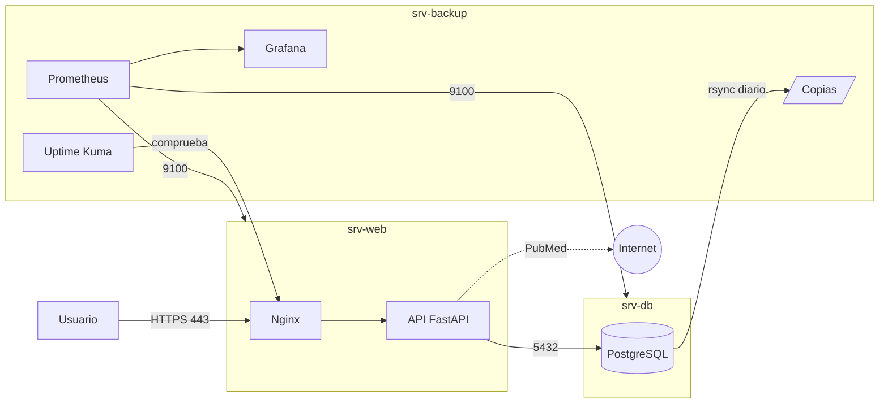

# 2. Arquitectura

## ¿Por qué tres máquinas?

| Máquina | Función | Motivo de separarla |
|---------|---------|---------------------|
| **srv-web** | Nginx (HTTPS) + API + web | Es la única expuesta a los usuarios. Si se compromete, los datos están en otra máquina. |
| **srv-db** | PostgreSQL | Solo acepta conexiones de srv-web. Se puede actualizar o restaurar sin tocar la web. |
| **srv-backup** | Copias y monitorización | Si srv-db se pierde, las copias siguen a salvo. Vigila a las otras dos desde fuera, así que detecta caídas aunque una máquina no responda. |

## Decisiones técnicas

| Decisión | Alternativa descartada | Motivo |
|----------|------------------------|--------|
| Docker Compose en cada máquina | Instalar todo directamente en el SO | Mismo entorno en desarrollo y producción; despliegue con un comando. |
| Un solo repositorio para las tres máquinas | Un repositorio por máquina | Cada máquina arranca solo su `infra/<máquina>/`, pero el código y la documentación van juntos. |
| PostgreSQL | MySQL/MariaDB | _Completar_ |
| FastAPI | Flask/Django | Documentación automática de la API (`/docs`), validación de datos. |
| Prometheus + Grafana + Uptime Kuma | Zabbix | _Completar_ |
