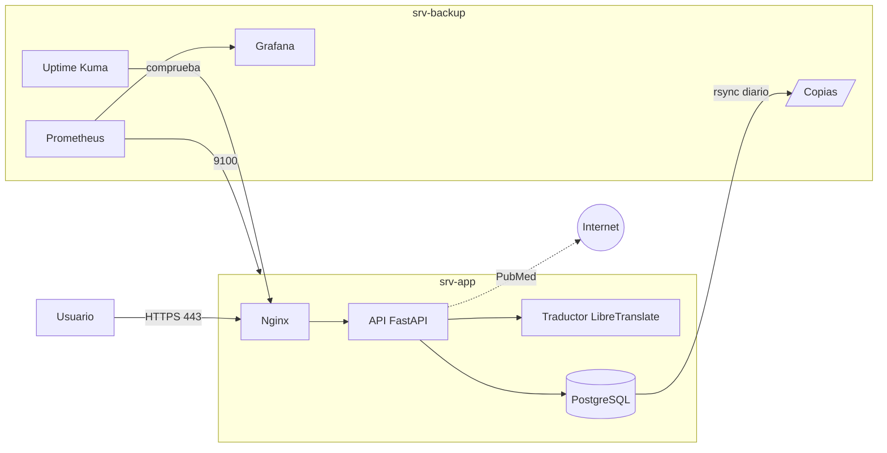

# 2. Arquitectura

## ¿Por qué dos máquinas?

| Máquina | Función | Motivo |
|---------|---------|--------|
| **srv-app** | Nginx (HTTPS) + web + API + traductor + PostgreSQL | Todo lo que necesita la aplicación para funcionar, en una sola máquina y un solo `compose.yaml`. |
| **srv-backup** | Copias y monitorización | Si srv-app se pierde, las copias siguen a salvo en otro equipo. Vigila a srv-app desde fuera, así que detecta caídas aunque srv-app no responda. |

Al principio la web y la base de datos iban en dos máquinas distintas
(srv-web y srv-db). Se unificaron en **srv-app** porque:

- Hay menos equipos físicos que mantener y la aplicación no depende de la red
  entre dos servidores ni de dos IPs por DHCP.
- PostgreSQL ya **no se publica en la red**: la API llega a él por una red
  interna de Docker (`172.30.0.0/24`). Desde fuera de la máquina el puerto 5432
  no existe, lo que es más seguro que abrirlo solo a una IP.

**Lo que se pierde:** si se compromete srv-app, el atacante está en la misma
máquina que los datos; y la web y la base de datos compiten por la misma RAM.
Se compensa con usuarios separados en PostgreSQL (la API usa `alpha_app`, que
no puede crear ni borrar tablas, y no recibe la contraseña del administrador)
y con las copias diarias en srv-backup.

## Decisiones técnicas

| Decisión | Alternativa descartada | Motivo |
|----------|------------------------|--------|
| Docker Compose en cada máquina | Instalar todo directamente en el SO | Mismo entorno en desarrollo y producción; despliegue con un comando. |
| Un solo repositorio para las dos máquinas | Un repositorio por máquina | Cada máquina arranca solo su `infra/<máquina>/`, pero el código y la documentación van juntos. |
| PostgreSQL | MySQL/MariaDB | _Completar_ |
| Web y base de datos en la misma máquina (srv-app) | Una máquina para cada una (srv-web + srv-db) | Menos equipos; PostgreSQL deja de estar expuesto en la red. Ver arriba. |
| FastAPI | Flask/Django | Documentación automática de la API (`/docs`), validación de datos. |
| LibreTranslate propio para traducir títulos y resúmenes | Google Translate / DeepL (API de pago) | Gratis, sin límite de uso y los textos no salen de nuestro servidor. Se traduce una vez al guardar el artículo, no en cada visita. |
| Prometheus + Grafana + Uptime Kuma | Zabbix | _Completar_ |
